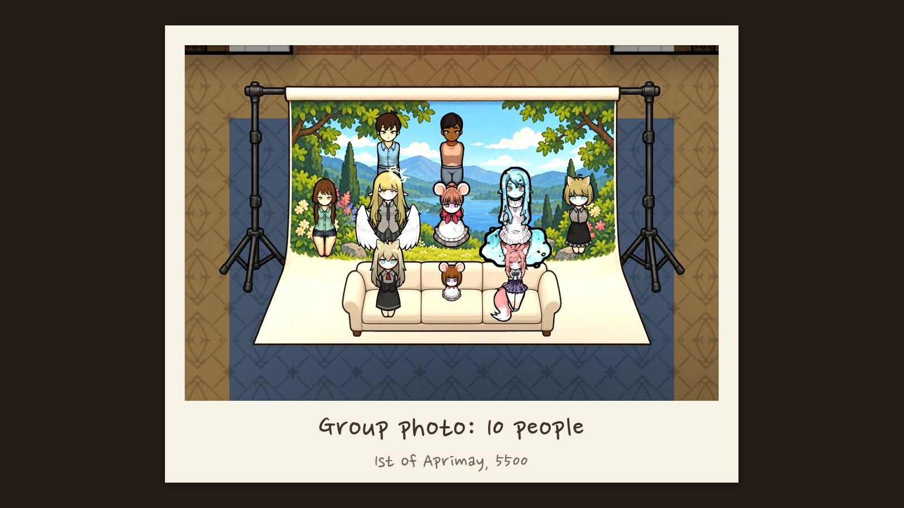
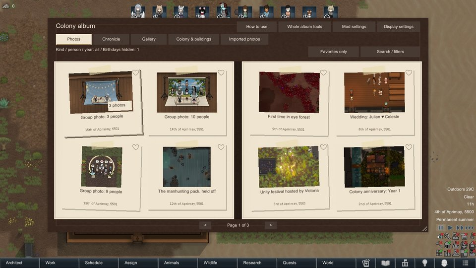
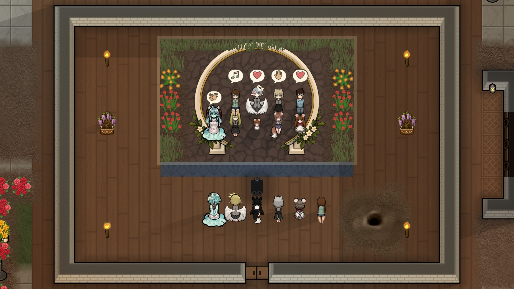

<h1 align="center">Moment Frames</h1>

<p align="center"><em>Keep a photo of the moments that made your colony.</em></p>

<p align="center">
  <a href="https://steamcommunity.com/sharedfiles/filedetails/?id=3835409869"><strong>Steam Workshop</strong></a>
  &nbsp;·&nbsp;
  <a href="https://github.com/rucy74/Rimworld-Moment-Frames/archive/refs/tags/v2.6.0.zip"><strong>Download v2.6.0</strong></a>
  &nbsp;·&nbsp;
  <a href="#한국어"><strong>한국어</strong></a>
</p>

<p align="center">
  
  <br>
  <sub>One of the colony’s group portraits, saved in-game.</sub>
</p>

**Moment Frames** photographs weddings, celebrations, and first visits as you play RimWorld. For a portrait of your own, gather the colony at a photo spot or studio, pick their emotes, and take the shot.

## The colony album

**Find an old favorite.** Browse the album by colonist or event, crop a photo while keeping the original, or export an album you can open offline. Quarterly photos let you see how the settlement changed over time.



**Look back together.** Hang a favorite on the wall, put a few on a memory tree, or bring the colony together for a slideshow on Memory Night.



## Get started

**RimWorld 1.6 and 1.7** · Requires [Harmony](https://steamcommunity.com/sharedfiles/filedetails/?id=2009463077)

- **Steam:** Subscribe on the [Workshop](https://steamcommunity.com/sharedfiles/filedetails/?id=3835409869), then enable Harmony and Moment Frames.
- **Manual install:** Extract the [v2.6.0 ZIP](https://github.com/rucy74/Rimworld-Moment-Frames/archive/refs/tags/v2.6.0.zip) into RimWorld’s `Mods` folder. Keep `About/About.xml` directly under the extracted mod folder. Enable one copy of Moment Frames.

Open **Album** in the game’s bottom bar. Choose **How to use** for step-by-step help with your first portrait.

<details>
<summary><strong>v2.6.0 · Photo formats and storage</strong></summary>

New photos are saved as JPG by default. To keep new shots as lossless PNG, change **Photo file format** in the mod settings. Existing PNG photos stay as they are.

To delete a photo from disk, remove it from the album, then delete it in **Archive**. Saves for the same colony share a photo folder, so older saves can also lose access to a photo you permanently delete.

[Full changelog](https://steamcommunity.com/sharedfiles/filedetails/changelog/3835409869)

</details>

## 한국어

**순간 액자**는 결혼식, 축제, 탐험처럼 정착지의 중요한 순간을 플레이 중에 사진으로 남겨요. 촬영 스팟이나 사진관에서 단체 사진을 직접 찍고, 앨범에 모아 액자나 추억의 밤에서 다시 볼 수 있어요.

림월드 **1.6·1.7**을 지원하고 [Harmony](https://steamcommunity.com/sharedfiles/filedetails/?id=2009463077)가 필요해요. [스팀 창작마당](https://steamcommunity.com/sharedfiles/filedetails/?id=3835409869)에서 구독하거나 [v2.6.0 ZIP](https://github.com/rucy74/Rimworld-Moment-Frames/archive/refs/tags/v2.6.0.zip)을 받아 게임의 `Mods` 폴더에 풀면 돼요. 게임 아래쪽의 **앨범 → 사용 안내**에서 첫 촬영을 따라 할 수 있어요.

새 사진은 기본 JPG로 저장돼요. 설정에서 무손실 PNG도 고를 수 있고, 예전 사진은 그대로예요. 파일까지 지우려면 사진을 앨범에서 뺀 뒤 **보관함**에서 삭제하세요. 같은 정착지의 이전 세이브에서도 그 사진을 열 수 없게 될 수 있어요.

<details>
<summary><strong>Build from source</strong></summary>

Use the .NET SDK with the RimWorld 1.6 managed assemblies and the 1.6 build of Harmony. The shared DLL also supports RimWorld 1.7 through its compatibility layer.

```powershell
dotnet build Source/MomentFrames.csproj -c Debug "-p:GameRoot=C:/path/to/RimWorld-1.6" "-p:HarmonyPath=C:/path/to/0Harmony.dll"
```

The build writes `Assemblies/MomentFrames.dll`. Font notices are in [Fonts](Fonts/).

</details>

<!-- 작성 이력
- 2026-11-24 00:18 — 공개판 README에 인게임 사진과 빠른 설치 안내를 추가.
-->
